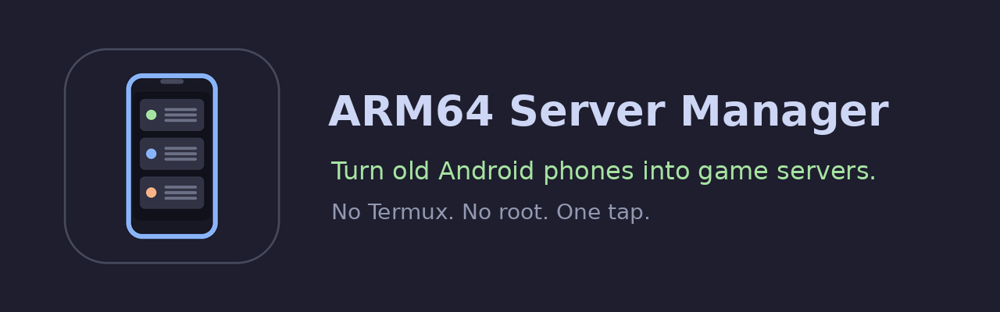

# ARM64 Server Manager

Mach aus alten (auch defekten) Android-Handys Spieleserver. Fertiges **Image** laden, **Installieren**, **Starten**. Kein Termux, kein Root, keine Kommandozeile.

🇬🇧 [English version](README.md)

## Funktionen
- Images per Klick installieren: aus einer **lokalen Datei** oder einer **GitHub-Release-URL**
- Start/Stop per Knopf, **interaktive Konsole** (Befehle an den Server oder Shell-Befehle)
- **Vordergrunddienst**, damit Server 24/7 auch bei ausgeschaltetem Display laufen
- Zusätzliche Knöpfe pro Image (z. B. *Download / Update server*, *Backup*), vom Image selbst definiert
- Deutsche / englische Oberfläche und Skript-Ausgaben
- Mehrere Images nebeneinander

## So funktioniert es
Ein Image ist eine `.tar.gz` mit komplettem Ubuntu, [proot](https://proot-me.github.io/) (ohne Root), [box64](https://github.com/ptitSeb/box64) (führt x86_64-Server auf ARM64 aus) und dem Server. Die App entpackt es in ihren privaten Speicher und startet `start.sh`.

## Schnellstart (Nutzer)
1. APK von der [Releases](../../releases)-Seite installieren („Unbekannte Apps installieren“ für Browser/Dateimanager erlauben).
2. App öffnen. **Benachrichtigungen** erlauben und Akku auf **Unbeschränkt** stellen (nötig für 24/7).
3. **Image hinzufügen** → *GitHub / URL* (Release-Link des Images einfügen) oder *Lokal* (heruntergeladene `.tar.gz` wählen).
4. **Installieren** tippen und warten (mehrere hundert MB, nur einmal).
5. **Server herunterladen (einmalig):** https://www.minecraft.net/en-us/download/server/bedrock öffnen, EULA akzeptieren und den Link bei **Ubuntu (Linux)** kopieren (Rechtsklick auf den Button → *Linkadresse kopieren*, endet auf `.zip`). In der App **Download / Update server** tippen und den Link einfügen.
6. **Starten** tippen. In Minecraft Bedrock mit `<Handy-IP>`, Port `19132` (UDP) beitreten.

> **Ports:** Für Mitspieler von außen UDP `19132` im Router freigeben.

### GrapheneOS / Netzwerkberechtigung
GrapheneOS hat pro App einen **Netzwerk**-Schalter (Einstellungen → Apps → *ARM64 Server Manager* → Berechtigungen → **Netzwerk**). Er muss **an** sein, sonst kann der Server keinen Port öffnen („Port may be in use“ / `Permission denied`).

### Minecraft-Server updaten
Server stoppen, **Download / Update server** tippen, den Link der neuen *Bedrock-Server für Linux* `.zip` von minecraft.net einfügen. Welten und `server.properties` bleiben erhalten.

### Servereinstellungen
**Settings / Einstellungen** öffnet `server.properties` (Spielmodus, Schwierigkeit, Spielerzahl, Weltname …) mit einfachen Schaltern und Feldern. Die Datei gibt es nach dem ersten Serverstart. Danach den Server neu starten.

### Backups
Server stoppen und **Backup** tippen. Die App packt die Welten in eine `.tar.gz` und kopiert sie nach **`Download/ARM64-Server-Manager/<Image>/`** auf dem Handy, von dort kommst du leicht an die Datei (PC, Cloud). Darf die App dort nicht schreiben, erlaube ihr *Dateien/Speicher* (Einstellungen → Apps → ARM64 Server Manager → Berechtigungen); bis dahin landet die Kopie im App-Ordner (`Android/data/<Paket>/files/backups`, per USB-Kabel am PC erreichbar). Die 5 neuesten Backups bleiben zusätzlich in der App.

## Images
| Image | Was es ist | Dateiname |
|---|---|---|
| Minecraft Bedrock | Offizieller Bedrock-Server über box64 | `bedrock-full.tar.gz` |
| Minecraft Java + Bedrock | Paper (Java) + Geyser/Floodgate, natives ARM64-Java 25 | `paper-full.tar.gz` |

Beide liegen im selben Release, z. B. `https://github.com/FGSeRaser/ARM64-Server-Manager/releases/download/v1.0.0/paper-full.tar.gz`. Der Mojang-Server ist nie Teil eines Images.

> **Beide Images nutzen Port 19132 (UDP)**, auf demselben Handy darf also nur eines gleichzeitig laufen.

### Paper-Image (Java + Bedrock zusammen)
1. Image installieren, dann **Download / Update server** tippen und `latest` (oder eine Version wie `1.21.8`) eingeben. Das lädt Paper, Geyser und Floodgate.
2. Einmal **Start** (beendet sich selbst), **Accept EULA** tippen ([Minecraft-EULA](https://aka.ms/MinecraftEULA)), nochmal **Start**, auf `Done` warten und mit `stop` beenden.
3. **Bedrock setup (Geyser)** tippen, dann **Start**. Damit können Bedrock-Spieler ohne Java-Konto beitreten, und NetherNet wird aktiviert (nötig für Bedrock 26.60+).
4. Java-Spieler: `<Handy-IP>:25565`, Bedrock-Spieler: `<Handy-IP>`, Port `19132`.
5. **RAM** stellt den Java-Speicher ein (Standard `2G`; bei Handys mit 4 GB eher `1G`-`1536M`).

Bedrock-Spieler haben kein Java-Konto, deshalb findet der normale Befehl `whitelist add` sie nicht. Die einfache Lösung, die funktioniert: Whitelist ausschalten (`whitelist off` in der Konsole und `white-list=false` unter **Settings**, damit es so bleibt). Floodgate hat zusätzlich einen eigenen Whitelist-Befehl, den ich nicht getestet habe. Für NetherNet brauchen Bedrock-Spieler TCP und UDP `19132` plus UDP `19133` (innerhalb von Tailscale nicht nötig).

### Mit Freunden übers Internet spielen: Tailscale
Statt Ports im Router freizugeben, kannst du [Tailscale](https://tailscale.com/download) nutzen (für private Nutzung kostenlos, Apps für Android, iOS, Windows, macOS und Linux):
1. Tailscale auf dem **Server-Handy** installieren und anmelden. Die Tailscale-Adresse (`100.x.y.z`) steht in der Tailscale-App.
2. Freunde erreichen es auf zwei Wegen: Entweder lädst du sie in dein Tailnet ein, oder du gibst nur das Server-Handy per [Node Sharing](https://tailscale.com/kb/1084/sharing) für ihr eigenes Tailscale-Konto frei.
3. Freunde installieren Tailscale auf Handy/PC und melden sich an.
4. In Minecraft Bedrock (Android, iOS, Windows) einen Server mit der Tailscale-Adresse des Server-Handys und Port `19132` hinzufügen.

Hinweise: Spielkonsolen können kein Tailscale, und Bedrock auf Konsolen hat kein freies „Server hinzufügen“-Feld, es geht also für Handy-/PC-Spieler. Unter GrapheneOS muss auch für Tailscale der **Netzwerk**-Schalter der App an sein. Ich habe diesen Aufbau selbst noch nicht getestet; wenn es bei dir nicht klappt, eröffne bitte ein Issue.

## Voraussetzungen
- Android 10+ (getestet: Pixel 9a / GrapheneOS, Android 17), ARM64-Handy, ca. 3 GB freier Speicher, mehr RAM ist besser (noch nicht gemessen)
- Handy dauerhaft am Strom (Akku-Mod oder Ladegerät)

## Selbst bauen
- App: [docs/BUILD-APP.md](docs/BUILD-APP.md)
- Eigenes Image aus einem Termux-Ubuntu: [docs/BUILD-IMAGE.md](docs/BUILD-IMAGE.md)
- Image-Format / weitere Server: [docs/IMAGE-FORMAT.md](docs/IMAGE-FORMAT.md)
- Probleme: [docs/TROUBLESHOOTING.md](docs/TROUBLESHOOTING.md)

## Rechtliches
Dieses Projekt steht in **keiner Verbindung zu Mojang oder Microsoft**. Für den Minecraft Bedrock Dedicated Server gelten EULA und Nutzungsrichtlinien; das Image enthält ihn deshalb **nicht**: Jeder Nutzer lädt ihn selbst von minecraft.net herunter. Ubuntu, box64 (MIT) und proot (GPL-2.0) haben eigene Lizenzen; wer proot-Binaries verteilt, muss den Quellcode zugänglich machen (https://github.com/proot-me/proot). Der App-Code steht unter MIT, siehe [LICENSE](LICENSE). Keine Rechtsberatung.

## Roadmap
Terraria, Killing Floor (box86) u. a.; gemeinsames Basis-Image + kleine Add-ons je Server.
